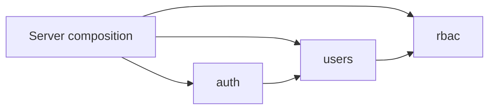

# Module architecture

[Documentation index](../README.md)

The backend is a single Go service with feature packages under `backend/internal/features/`. Each module owns its HTTP routes and handlers; account and role persistence remain in the shared PostgreSQL database.

| Module            | Owns                                                                              | Main dependencies                                             |
| ----------------- | --------------------------------------------------------------------------------- | ------------------------------------------------------------- |
| [auth](auth.md)   | Public signup, login, JWT issuance, own-profile endpoint                          | Users repository and account-creation service                 |
| [users](users.md) | Account records, account creation, active-account middleware, user administration | RBAC role model, permission gate, and `RoleCatalog` interface |
| [rbac](rbac.md)   | Role catalog, permission assignments, permission middleware                       | PostgreSQL; no auth or users package dependency               |
| health            | Process and database probes                                                       | PostgreSQL connection pool                                    |
| apidocs           | Public Swagger UI and OpenAPI asset routes                                        | Root `docs/api/` filesystem                                   |

## Composition and dependencies

`backend/cmd/server/main.go` creates a shared pgx connection pool, constructs the users repository and service, and constructs the RBAC repository. The RBAC repository satisfies the users handler's `RoleCatalog` interface. The server then registers each module separately under `/api/v1`.

`users.User` implements RBAC's `PermissionHolder` interface. RBAC checks that interface instead of importing the users package, avoiding a package cycle. The users repository joins account records to roles and permissions when resolving the current user; this is a shared-database module boundary, not separate database ownership per service.

## Protected request flow

1. JWT middleware in `internal/middleware/jwt.go` validates the HS256 signature, expiration, and positive integer subject. It sets `user_id` in Fiber locals.
2. `users.ActiveUser` loads the user and current permissions from PostgreSQL. Missing accounts return 401, disabled accounts return 403, and database failures return 500.
3. The account is stored under `rbac.PrincipalKey` (`current_user`).
4. Management routes run `rbac.RequirePermission` for each required permission. Missing permissions return 403.
5. The handler validates input and calls its repository or account service.

Public registration and login have separate rate limiters. `/auth/me` requires an active account but no management permission. Health probes and Swagger routes are public.

## Shared packages and storage

- `internal/pkg/request`: strict JSON decoding and positive path-ID parsing.
- `internal/pkg/response`: JSON success/error helpers. JWT rejection has additional response formats; see the [API reference](../api/README.md).
- `internal/pkg/validator`: request validation and field error formatting.
- `internal/database`: embedded, versioned PostgreSQL migrations.
- `internal/config`: environment configuration and database DSN construction.

No schema changes were needed for the module split. Migration 1 preserves the legacy schema. Migration 2 establishes canonical roles, normalized email uniqueness, and permission mappings.

## Adding a feature or changing a contract

Keep route registration in the owning module and compose it in `cmd/server/main.go`. Protect new management routes with JWT, active-account, and permission middleware. Define business permissions and organization scoping alongside the feature; the current RBAC policy covers account management only.

When changing an API, update [`../api/openapi.json`](../api/openapi.json), the relevant module guide, and cross-module tests together. Keep documentation source in root `docs/`; do not create a second generated OpenAPI copy under `backend/`.

`internal/integration/auth_rbac_test.go` tests the modules together against disposable PostgreSQL databases. `make test` runs the Go suite; set `TEST_DATABASE_URL` and run `make test-integration` for database-backed coverage.
